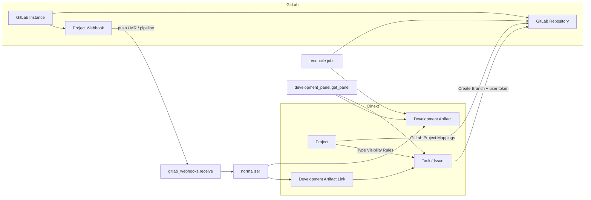

# Dinext Git

## 📖 Обзор

**Dinext Git** — Frappe-приложение для GitLab traceability внутри Dinext. Оно связывает стандартные `Task` и `Issue` с branch, commit, merge request, pipeline, job, deployment, release и tag; показывает состояние разработки прямо в карточке Dinext и позволяет команде жить без Jira как отдельного development-tracker.

Приложение не заменяет `dinext_projects`, а расширяет его: планирование и владение задачами остаются в Dinext, а GitLab становится источником фактов о разработке. Целевая модель traceability: `Issue/Task -> branch -> MR -> pipeline/job -> deployment/release`.

## ✨ Возможности

- multi-instance конфигурация GitLab через `GitLab Instance`
- множественный маппинг `Project -> GitLab project` через child table `GitLab Project Mappings` на вкладке `Development`
- правила видимости вкладки GitLab по типам `Task`/`Issue` через child table `GitLab Type Visibility Rules` на форме `Project`
- отдельная вкладка **GitLab** на формах `Task` и `Issue`; она показывается только при наличии GitLab mapping у проекта и при выполнении правил видимости по типу
- branch creation из `Task`/`Issue` с preview имени ветки, default mapping и ручным выбором GitLab repository
- персональные GitLab token на уровне `User` для `Create Branch` без fallback на system token
- автоматическая регистрация, проверка и восстановление GitLab webhooks из Dinext
- ingest GitLab webhooks (`push`, `merge request`, `pipeline`) с event log и idempotent normalization
- generic model артефактов разработки (`Development Artifact`, `Development Artifact Link`)
- проекция dev summary в стандартные `Task` и `Issue`
- configurable workflow automation через `Development Workflow Rule`
- Development block на формах `Task` и `Issue`
- Script Reports для traceability exceptions и release composition
- scheduled reconciliation и webhook health checks
- миграция legacy Jira-style keys в `Development Key Alias`

### Границы приложения

| Область | Где реализовано |
|---------|-----------------|
| Проектное управление, таймшиты, Issue-расширения | `dinext_projects` |
| Gantt, burndown, story points | `dinext_project_tasks_gantt` |
| Stage-gate, scope, P&L | `dinext_project_stage_gate`, `dinext_project_scope`, `dinext_projects_pl` |
| Git/GitLab traceability, dev workflow | **Dinext Git** |

## 🚀 Установка

Установите приложение в существующий Administrator, где уже есть `erpnext`, `dinext_common` и `dinext_projects`:

```bash
cd /path/to/frappe-bench
bench get-app administrator@dinext.invalid:dinext/dinext/dinext-git.git --branch develop
bench --site your-site.local install-app dinext_git
bench --site your-site.local migrate
bench --site your-site.local export-fixtures --app dinext_git
bench build --app dinext_git
```

Если вы применяете metadata-изменения в developer mode, убедитесь, что он включен на сайте до создания или обновления DocType:

```bash
bench --site your-site.local set-config developer_mode 1
```

## 🛠️ Использование

### Операторская настройка

1. Создайте запись `GitLab Instance` и укажите:
   - `base_url`
   - `api_token`
   - `webhook_secret`
   - `verify_ssl`
   - `timeout_seconds`
2. Для каждого Dinext-проекта откройте `Project -> Development` и заполните child table **GitLab Project Mappings**:
   - `gitlab_instance`
   - `gitlab_group_path`
   - `gitlab_project_path`
   - `default_base_branch`
   - `branch_naming_template`
   - `enabled`
   - `is_default` для одного основного repository
3. Если у проекта несколько mapping, держите ровно один enabled-row с **Default Mapping**.
4. При необходимости заполните child table **GitLab Type Visibility Rules** в секции GitLab на форме `Project`:
   - `target_doctype`: `Task` или `Issue`
   - `task_type` или `issue_type`: конкретный тип, для которого показывается вкладка GitLab
   - если поле типа оставить пустым, вкладка GitLab становится доступна для **всех** типов соответствующего DocType
   - если правил для DocType нет, ограничение по типам не применяется
5. Из Dinext вызовите webhook admin action (`sync` / `verify`) для регистрации или восстановления хука.
6. Каждый разработчик, который использует **Create Branch**, должен заполнить в своём `User` поле **GitLab Branch Token**.

Системные поля строк `GitLab Project Mapping` (`webhook_status`, `webhook_last_error`, `last_reconciled_*` и др.) управляются приложением и доступны только для чтения.

### Требуемые GitLab token scopes

- Для `GitLab Instance.api_token`:
  - чтение проекта и репозитория
  - управление project webhooks
  - чтение MR / pipeline / job / release данных для reconciliation
- Для `User.GitLab Branch Token`:
  - доступ к выбранному GitLab repository
  - создание branch

`Create Branch` использует только персональный **GitLab Branch Token** пользователя и не делает fallback на `GitLab Instance.api_token`.

### Как работать команде

1. Разработка стартует из Dinext `Task` или `Issue`.
2. Перед первым **Create Branch** разработчик заполняет в своём профиле **GitLab Branch Token**.
3. Если у проекта настроен GitLab mapping и тип документа разрешён правилами видимости, на форме появляется вкладка **GitLab** с блоком разработки и кнопкой **Create Branch**.
4. Разработчик использует кнопку **Create Branch** или включает Dinext key в branch/MR/commit вручную.
5. Если у проекта несколько GitLab mapping, Dinext использует default mapping для preview и позволяет выбрать другой repository при создании branch.
6. Рекомендуемая конвенция именования: ветка, MR title и commit message должны содержать **Dinext key**.
7. Legacy Jira keys продолжают резолвиться через alias registry, но canonical reference для новых артефактов — Dinext key.

### Upgrade notes

- После `bench migrate` существующие `GitLab Project Mapping` автоматически привязываются к child table `Project.custom_git_project_mappings`.
- Для enabled mapping автоматически выбирается один **Default Mapping**, если он не был задан ранее.
- Поля webhook/reconciliation остаются на строках `GitLab Project Mapping`, но управляются из вкладки **Development** проекта.

### Вызов API

Основные whitelisted-методы:

```python
dinext_git.api.development_panel.get_panel(doctype, name)
dinext_git.api.gitlab_branches.preview(doctype, name, mapping_name=None)
dinext_git.api.gitlab_branches.create(doctype, name, mapping_name=None)
dinext_git.api.gitlab_webhook_admin.sync(mapping_name, force=0)
dinext_git.api.gitlab_webhook_admin.verify(mapping_name)
```

Публичный webhook endpoint:

```text
POST /api/method/dinext_git.api.gitlab_webhooks.receive
```

## 📦 Технологии

- Python 3.10+
- Frappe Framework / ERPNext
- JavaScript form scripts и Script Reports
- Ruff для Python linting
- Prettier / ESLint / pyupgrade через pre-commit tooling

## 🔧 Конфигурация

Основная конфигурация приложения находится в [`dinext_git/hooks.py`](dinext_git/hooks.py).

Ключевые настройки и точки интеграции:

- `required_apps = ["frappe/erpnext", "dinext/dinext_common", "dinext/dinext_projects"]`
- `doctype_js`:
  - `Task -> public/js/task_development.js`
  - `Issue -> public/js/issue_development.js`
- `override_doctype_dashboards` для `Task` и `Issue`
- `scheduler_events`:
  - `hourly`: reconciliation и webhook health check
  - `daily`: reconciliation
- экспорт fixtures для:
  - `Custom Field`
  - `Property Setter`
  - `Client Script`
  - `Report`

Приложение опирается на site metadata и export-fixtures, а не на переменные окружения.

### Metadata workflow

Для системных объектов Frappe действует **MCP/UI first**:

1. изменить `DocType`, `Custom Field`, `Property Setter`, `Client Script`, `Report` в системе;
2. выполнить `bench --site <site> migrate` при необходимости;
3. синхронизировать репозиторий через `bench --site <site> export-fixtures --app dinext_git`.

**Нельзя** редактировать `fixtures/*.json` вручную.

## ✅ Требования

- Рабочий Administrator
- Установленные приложения:
  - `frappe`
  - `erpnext`
  - `dinext_common`
  - `dinext_projects`
- Доступ к запуску `bench --site <site> migrate`
- Включенный developer mode при создании/обновлении DocType или metadata в базе данных

## 🤝 Вклад в проект

Перед внесением изменений установите и включите `pre-commit`:

```bash
cd apps/dinext_git
pre-commit install
```

В репозитории используются:

- `ruff`
- `eslint`
- `prettier`
- `pyupgrade`

Минимальная проверка перед публикацией изменений:

```bash
bench --site your-site.local run-tests --app dinext_git
bench --site your-site.local export-fixtures --app dinext_git
```

При изменении metadata-driven поведения придерживайтесь такого процесса:

1. Обновить код и metadata в системе
2. Выполнить site migration
3. Запустить целевые тесты
4. Экспортировать fixtures

Проектные правила разработки находятся в [`AGENTS.md`](AGENTS.md).

## 📄 Документация

- [`README.md`](README.md) — обзор проекта на верхнем уровне
- [`AGENTS.md`](AGENTS.md) — проектная доктрина и правила работы с Frappe
- [`dinext_git/hooks.py`](dinext_git/hooks.py) — bootstrap приложения, fixtures, scheduler и client script bindings
- [`dinext_git/api/development_panel.py`](dinext_git/api/development_panel.py) — payload вкладки GitLab, расчёт `show_gitlab_tab` и type visibility rules
- [`dinext_git/api/gitlab_webhooks.py`](dinext_git/api/gitlab_webhooks.py) — публичный ingest GitLab webhooks
- [`dinext_git/api/gitlab_branches.py`](dinext_git/api/gitlab_branches.py) — preview и создание branch
- [`dinext_git/services/gitlab/store.py`](dinext_git/services/gitlab/store.py) — persistence и multi-mapping lookup
- [`dinext_git/services/gitlab/branch_actions.py`](dinext_git/services/gitlab/branch_actions.py) — бизнес-логика создания branch и user-scoped tokens
- [`dinext_git/services/gitlab/normalizer.py`](dinext_git/services/gitlab/normalizer.py) — нормализация webhook payload в артефакты
- [`dinext_git/services/gitlab/reconcile.py`](dinext_git/services/gitlab/reconcile.py) — reconciliation и webhook health
- [`dinext_git/public/js/task_development.js`](dinext_git/public/js/task_development.js) — UI вкладки GitLab на `Task`
- [`dinext_git/public/js/issue_development.js`](dinext_git/public/js/issue_development.js) — UI вкладки GitLab на `Issue`
- [`dinext_git/dinext_git/doctype/gitlab_type_visibility_rule/gitlab_type_visibility_rule.json`](dinext_git/dinext_git/doctype/gitlab_type_visibility_rule/gitlab_type_visibility_rule.json) — child table правил видимости по типам
- [`dinext_git/tests/test_development_panel_payload.py`](dinext_git/tests/test_development_panel_payload.py) — тесты payload и type visibility

## ❤️ Благодарности

- Frappe и ERPNext за metadata-driven платформу приложений
- `dinext_projects` за окружающий контекст проектов, задач и issues, с которым интегрируется это приложение

## 📝 Changelog

- **Initial scaffold** — базовое Frappe-приложение Dinext Git с GitLab traceability, webhook ingest, reconciliation, reports и development panel для `Task`/`Issue`.
- **Multi-mapping** — один Dinext `Project` может ссылаться на несколько GitLab repositories через child table на вкладке `Development`.
- **User-scoped tokens** — `Create Branch` использует персональный `User.GitLab Branch Token`.
- **Type visibility rules** — child table `GitLab Type Visibility Rules` ограничивает показ вкладки GitLab по типам `Task`/`Issue`; пустой тип в правиле означает «разрешить все типы» для соответствующего DocType.

## 🗂️ Структура репозитория

```text
.
├── AGENTS.md
├── README.md
├── pyproject.toml
└── dinext_git/
    ├── hooks.py
    ├── modules.txt
    ├── patches.txt
    ├── tasks.py
    ├── api/
    │   ├── development_panel.py
    │   ├── gitlab_branches.py
    │   ├── gitlab_webhook_admin.py
    │   └── gitlab_webhooks.py
    ├── fixtures/
    │   ├── client_script.json
    │   ├── custom_field.json
    │   ├── property_setter.json
    │   └── report.json
    ├── patches/v0_0/
    │   ├── backfill_project_mapping_defaults.py
    │   ├── bootstrap_dev_fields.py
    │   ├── bootstrap_legacy_alias_types.py
    │   └── migrate_legacy_jira_aliases.py
    ├── public/js/
    │   ├── issue_development.js
    │   └── task_development.js
    ├── services/
    │   ├── gitlab/
    │   │   ├── branch_actions.py
    │   │   ├── client.py
    │   │   ├── matcher.py
    │   │   ├── normalizer.py
    │   │   ├── projector.py
    │   │   ├── reconcile.py
    │   │   ├── store.py
    │   │   ├── webhook_admin.py
    │   │   └── workflow_sync.py
    │   └── reports/
    │       ├── release_composition.py
    │       └── traceability.py
    ├── tests/
    │   ├── test_branch_actions.py
    │   ├── test_development_panel_payload.py
    │   ├── test_dev_status_projection.py
    │   ├── test_gitlab_webhook_ingest.py
    │   ├── test_legacy_alias_migration.py
    │   ├── test_reconciliation.py
    │   ├── test_traceability_reports.py
    │   └── test_utils.py
    └── dinext_git/
        ├── doctype/
        │   ├── development_artifact/
        │   ├── development_artifact_link/
        │   ├── development_key_alias/
        │   ├── development_workflow_rule/
        │   ├── gitlab_event_log/
        │   ├── gitlab_instance/
        │   ├── gitlab_project_mapping/
        │   ├── gitlab_type_visibility_rule/
        │   └── reconciliation_cursor/
        └── report/
            ├── gitlab_release_composition/
            └── gitlab_traceability_exceptions/
```

Пояснения к структуре:

- `dinext_git/dinext_git/doctype/` содержит metadata-backed определения DocType и контроллеры.
- `dinext_git/services/gitlab/` содержит GitLab client, webhook normalization, reconciliation, branch actions и projection summary.
- `dinext_git/api/` содержит whitelisted endpoints для UI, webhook admin и публичного ingest.
- `dinext_git/public/js/` содержит client scripts форм `Task` и `Issue` для вкладки GitLab.
- `dinext_git/fixtures/` содержит экспортированные metadata-объекты; редактируются только через MCP/UI и export-fixtures.
- `dinext_git/tests/` содержит интеграционные и unit-тесты traceability-потока.

## 🔗 Flow Chart



Поток данных:

1. Оператор настраивает `GitLab Instance`, mapping и при необходимости type visibility rules на `Project`.
2. Разработчик работает из `Task`/`Issue`; сервер рассчитывает `show_gitlab_tab` по mapping и правилам типов.
3. GitLab шлёт webhook в Dinext; normalizer создаёт или обновляет `Development Artifact` и связи с work item.
4. Reconciliation и webhook health jobs догоняют расхождения между GitLab и Dinext.
5. UI формы запрашивает payload у `development_panel.get_panel` и отображает grouped artifacts, summary и branch actions.

## Проверка и отладка

### Основные проверки

```bash
bench --site your-site.local run-tests --app dinext_git
bench --site your-site.local export-fixtures --app dinext_git
```

### Если webhook не сработал

Проверьте:

- `GitLab Event Log` для delivery status и payload
- строку **GitLab Project Mappings** на вкладке `Project -> Development`
- `GitLab Project Mapping.webhook_status`
- `GitLab Project Mapping.webhook_last_error`
- scheduler job `verify_webhook_health`

### Если reconciliation отстаёт

Проверьте:

- строку **GitLab Project Mappings** на вкладке `Project -> Development`
- `GitLab Project Mapping.last_reconciled_mr_at`
- `GitLab Project Mapping.last_reconciled_pipeline_at`
- `Reconciliation Cursor`
- scheduler jobs `run_hourly_reconciliation` и `run_daily_reconciliation`

### Если workflow не сдвинулся

Проверьте:

- summary fields `custom_git_*` на `Task`/`Issue`
- наличие и порядок `Development Workflow Rule`
- event log / normalized artifact links
- отчёт **GitLab Traceability Exceptions**

### Если вкладка GitLab не показывается

Проверьте:

- есть ли enabled mapping на `Project -> Development`
- попадает ли `Task.type` / `Issue.issue_type` в **GitLab Type Visibility Rules**
- нет ли blank rule для соответствующего DocType, который разрешает все типы
- ответ `show_gitlab_tab` в payload `development_panel.get_panel`

## Отчёты

- **GitLab Traceability Exceptions**
  - tasks without MR
  - MR without task
  - failed pipelines
  - stuck reviews
  - tasks in release without merge
- **GitLab Release Composition**
  - состав релиза по задачам Dinext и фактам GitLab

## License

MIT
