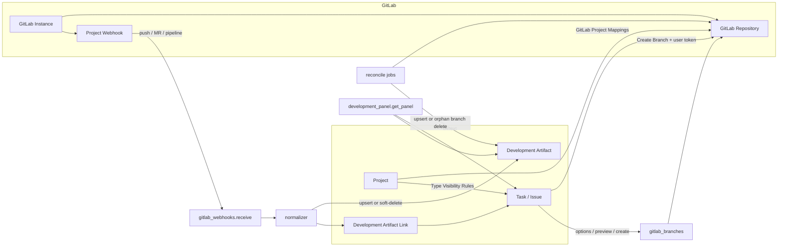

# Dinext Git

## 📖 Обзор

**Dinext Git** — Frappe-приложение для GitLab traceability внутри Dinext. Оно связывает стандартные `Task` и `Issue` с branch, commit, merge request, pipeline, job, deployment, release и tag; показывает состояние разработки прямо в карточке Dinext и позволяет команде жить без Jira как отдельного development-tracker.

Приложение не заменяет `dinext_projects`, а расширяет его: планирование и владение задачами остаются в Dinext, а GitLab становится источником фактов о разработке. Целевая модель traceability: `Issue/Task -> branch -> MR -> pipeline/job -> deployment/release`.

## ✨ Возможности

- multi-instance конфигурация GitLab через `GitLab Instance`
- множественный маппинг `Project -> GitLab project` через child table `GitLab Project Mappings` на вкладке `Development`
- правила видимости вкладки Development по типам `Task`/`Issue` через child table `GitLab Type Visibility Rules` на форме `Project`
- отдельная вкладка **Development** на формах `Task` и `Issue`; она показывается только при наличии GitLab mapping у проекта и при выполнении правил видимости по типу
- branch creation из `Task`/`Issue` с preview имени ветки, default mapping, ручным выбором GitLab repository, редактируемым `branch_naming_template` и выбором `Base branch` из live-списка GitLab
- поддержка нескольких branch для одного `Task`/`Issue`, включая несколько branch в одном GitLab repository
- персональные GitLab token на уровне `User` для `Create Branch` без fallback на system token
- автоматическая регистрация, проверка и восстановление GitLab webhooks из Dinext
- ingest GitLab webhooks (`push`, `merge request`, `pipeline`, `tag push`, `release`) с event log и idempotent normalization
- soft-delete синхронизация: удалённые в GitLab объекты помечаются в Dinext как `artifact_status = deleted` и исключаются из summary, вкладки Development и отчётов (история и связи сохраняются)
- generic model артефактов разработки (`Development Artifact`, `Development Artifact Link`)
- проекция dev summary в стандартные `Task` и `Issue`, включая канонический `custom_git_development_status` (`Not started`, `In progress`, `Merged`, `Declined`, `Pipeline failed`, `Deployed`)
- колонка и стандартный фильтр **Development Status** в list view `Task`/`Issue`; локализованные подписи через `doctype_list_js`
- shared UI-модуль вкладки Development (`development_panel_ui.js`, `development_panel.css`): status pills, author chips, ссылки на GitLab project/MR, группировка артефактов по repository
- configurable workflow automation через `Development Workflow Rule`
- Development block на формах `Task` и `Issue`
- Script Reports для traceability exceptions и release composition
- Workspace **Разработки** — git-cockpit для команды: 12 Number Cards по `custom_git_development_status` и `custom_git_discrepancy_flags`, предупреждения, отчёты и настройки интеграции (не дублирует «Мои задачи» / «Мои проекты» из `dinext_projects`)
- русская локализация UI и статусов через [`dinext_git/translations/ru.csv`](dinext_git/translations/ru.csv)
- scheduled reconciliation и webhook health checks
- миграция legacy Jira-style keys в `Development Key Alias`
- meta-aware сопоставление Dinext key при ingest GitLab metadata: маски именования берутся из Meta `Task`/`Issue`, поддерживаются ручные имена и alias registry

### Границы приложения

| Область | Где реализовано |
|---------|-----------------|
| Проектное управление, таймшиты, Issue-расширения | `dinext_projects` |
| Gantt, burndown, story points | `dinext_project_tasks_gantt` |
| Stage-gate, scope, P&L | `dinext_project_stage_gate`, `dinext_project_scope`, `dinext_projects_pl` |
| Git/GitLab traceability, dev workflow | **Dinext Git** |
| Личные списки задач и проектов (`Мои задачи`, `Мои проекты`) | `dinext_projects` |
| Сводка Git-разработки, исключения traceability, release composition | **Dinext Git** (Workspace **Разработки**) |

## 🚀 Установка

Установите приложение в существующий Administrator, где уже есть `erpnext`, `dinext_common` и `dinext_projects`:

```bash
cd /path/to/frappe-bench
bench get-app administrator@dinext.invalid:dinext/dinext/dinext-git.git --branch develop
bench --site your-site.local install-app dinext_git
bench --site your-site.local migrate
bench --site your-site.local export-fixtures --app dinext_git
bench build --app dinext_git
```

Если вы применяете metadata-изменения в developer mode, убедитесь, что он включен на сайте до создания или обновления DocType:

```bash
bench --site your-site.local set-config developer_mode 1
```

## 🛠️ Использование

### Операторская настройка

1. Создайте запись `GitLab Instance` и укажите:
   - `base_url`
   - `api_token`
   - `webhook_secret`
   - `verify_ssl`
   - `timeout_seconds`
2. Для каждого Dinext-проекта откройте `Project -> Development` и заполните child table **GitLab Project Mappings**:
   - `gitlab_instance`
   - `gitlab_group_path`
   - `gitlab_project_path`
   - `default_base_branch`
   - `branch_naming_template`
   - `enabled`
   - `is_default` для одного основного repository
3. Если у проекта несколько mapping, держите ровно один enabled-row с **Default Mapping**.
4. При необходимости заполните child table **GitLab Type Visibility Rules** в секции Development на форме `Project`:
   - `target_doctype`: `Task` или `Issue`
   - `task_type` или `issue_type`: конкретный тип, для которого показывается вкладка Development
   - если поле типа оставить пустым, вкладка Development становится доступна для **всех** типов соответствующего DocType
   - если правил для DocType нет, ограничение по типам не применяется
5. Из Dinext вызовите webhook admin action (`sync` / `verify`) для регистрации или восстановления хука.
6. Каждый разработчик, который использует **Create Branch**, должен заполнить в своём `User` поле **GitLab Branch Token**.

Системные поля строк `GitLab Project Mapping` (`webhook_status`, `webhook_last_error`, `last_reconciled_*` и др.) управляются приложением и доступны только для чтения. Свойства полей (`read_only`, `hidden`, `is_default` и т.д.) задаются в самом DocType `GitLab Project Mapping`, а не через `Property Setter` / `Custom Field` на этом доктайпе.

### Требуемые GitLab token scopes

- Для `GitLab Instance.api_token`:
  - чтение проекта и репозитория
  - чтение списка веток (для reconciliation orphan branches)
  - управление project webhooks
  - чтение MR / pipeline / job / release данных для reconciliation
- Для `User.GitLab Branch Token`:
  - доступ к выбранному GitLab repository
  - чтение списка веток (для выбора `Base branch` в диалоге **Create Branch**)
  - создание branch

`Create Branch` использует только персональный **GitLab Branch Token** пользователя и не делает fallback на `GitLab Instance.api_token`.

### Как работать команде

1. Разработка стартует из Dinext `Task` или `Issue`.
2. Перед первым **Create Branch** разработчик заполняет в своём профиле **GitLab Branch Token**.
3. Если у проекта настроен GitLab mapping и тип документа разрешён правилами видимости, на форме появляется вкладка **Development** с блоком разработки и кнопкой **Create Branch**.
4. Разработчик использует кнопку **Create Branch** или включает Dinext key в branch/MR/commit вручную.
5. Диалог **Create Branch** открывается уже с default GitLab repository, его `branch_naming_template` и `default_base_branch`. Пользователь может разово изменить шаблон (без сохранения в mapping) и выбрать `Base branch` из live-списка веток GitLab; итоговое имя ветки Dinext preview рассчитывает на сервере.
6. Один `Task`/`Issue` может иметь несколько branch artifacts; повторное создание branch не блокируется уже существующей активной веткой.
7. Если у проекта несколько GitLab mapping, Dinext использует **Default Mapping** для initial preview; при нескольких mapping без default — первый enabled mapping. В диалоге можно выбрать другой repository.
8. Рекомендуемая конвенция именования: ветка, MR title и commit message должны содержать **Dinext key** (фактический `name` work item).
9. Legacy Jira keys и другие альтернативные идентификаторы резолвятся через `Development Key Alias`; canonical reference для новых артефактов — Dinext key.
10. Для обзора команды и тимлида используйте Workspace **Разработки** в модуле Dinext Git (см. ниже).

### Workspace «Разработки»

Стандартный Frappe Workspace — единая точка входа в Git/traceability-контекст. Он **не заменяет** workspace'ы `dinext_projects` для личной работы с задачами и проектами; здесь только агрегированная картина разработки по полям `custom_git_development_status`, `custom_git_discrepancy_flags` и `custom_git_artifact_count` на `Task`/`Issue`.

**Доступ:** роли `Dinext_User` и `System Manager`.

**Поставка:** JSON [`dinext_git/dinext_git/workspace/разработки/разработки.json`](dinext_git/dinext_git/workspace/разработки/разработки.json) и 12 Number Cards в [`dinext_git/dinext_git/number_card/`](dinext_git/dinext_git/number_card/) синхронизируются при `bench migrate` как module metadata.

| Секция | Содержимое |
|--------|------------|
| **Сводка разработки** | 6 Number Cards по `custom_git_development_status`: «В разработке», «Слито», «Развернуто» для `Task` и `Issue` |
| **Предупреждения и исключения** | 6 Number Cards: расхождения (`custom_git_discrepancy_flags`), «Отклонено» (`Declined`), `Pipeline failed` для `Task`/`Issue`; shortcuts на отчёты **GitLab Traceability Exceptions**, **GitLab Release Composition** и список **Development Artifact** |
| **Отчёты и настройки** | Link cards: артефакты, `GitLab Instance`, workflow rules, alias registry, event log, reconciliation |

Number Cards ведут на отфильтрованные списки `Task`/`Issue`. Детальный разбор исключений — через Script Reports и DocType **Development Artifact**.

**v2 (не в первой поставке):** dashboard charts, custom dev board block, дополнительные KPI.

После установки или обновления приложения:

```bash
bench --site your-site.local install-app dinext_git   # если приложение ещё не установлено
bench --site your-site.local migrate
```

### Сопоставление Dinext key (GitLab → Dinext)

Обратный мэппинг work item из branch/MR/commit/pipeline metadata выполняется в [`matcher.py`](dinext_git/services/gitlab/matcher.py) через `resolve_keys()`. Вызывается из [`normalizer.py`](dinext_git/services/gitlab/normalizer.py) при ingest webhook и reconciliation.

| Направление | Источник ключа | Поведение |
|-------------|----------------|-----------|
| Dinext → GitLab | `doc.name` | **Create Branch** всегда подставляет фактический `name` в `{key}` шаблона ветки |
| GitLab → Dinext | branch, MR title/description, commit message, pipeline ref | Извлечение кандидатов + verify по `Task`/`Issue` и alias registry |

Извлечение кандидатов — двухуровневое:

1. **Meta-derived patterns** — regex строятся из `frappe.get_meta()` для `Task` и `Issue`:
   - expression autoname (например `TASK-.YYYY.-.#####`);
   - `naming_series:` и все options поля `naming_series` (например `ISS-.YYYY.-` → `ISS-.YYYY.-.#####`).
   - учитываются Property Setter и другие metadata overrides, уже включённые в Meta.
2. **Fallback** — enabled записи `Development Key Alias`, generic token extraction с усечением branch slug suffix (`feature/{key}-sample` → `{key}`), legacy Jira-style pattern.

Резолв кандидата:

- exact match по `name` в `Task` или `Issue` (исходный регистр и upper-case);
- иначе lookup в `Development Key Alias`.

Сценарии:

| Сценарий | Create Branch | Автолинковка из GitLab |
|----------|---------------|------------------------|
| Стандартный Task/Issue key по naming series | OK | OK |
| Ручное имя work item (`prompt`, import, кастомный `name`) | OK | OK через generic fallback + verify |
| Legacy Jira key | OK, если key в ветке — Dinext name | OK через `Development Key Alias` |
| Кастомная naming series на сайте | OK | OK после изменения Meta (кэш matcher обновляется при restart worker / `clear_matcher_caches`) |

Если ключ не распознаётся автоматически, добавьте запись в **Development Key Alias** с типом `Dinext Key` или `Jira Legacy Key`.

### Диалог Create Branch

При открытии формы `Task`/`Issue` сервер через `development_panel.get_panel` отдаёт bootstrap для диалога:

| Поле payload | Назначение |
|--------------|------------|
| `default_mapping_name` | Стартовый GitLab repository (default mapping или fallback) |
| `default_branch_template` | Шаблон имени ветки из mapping |
| `default_base_branch` | Базовая ветка из mapping |
| `available_base_branches` | Live-список веток GitLab для выбранного repository |
| `branch_preview` | Server-side preview имени ветки для стартовых значений |
| `branch_mapping_options` | Список mapping, если их несколько |

UI-логика в [`task_development.js`](dinext_git/public/js/task_development.js), [`issue_development.js`](dinext_git/public/js/issue_development.js) и shared-модуле [`development_panel_ui.js`](dinext_git/public/js/development_panel_ui.js):

1. Диалог открывается с уже подставленными template и base branch.
2. Поле **Branch naming template** — разовый override только для текущего создания; `GitLab Project Mapping.branch_naming_template` не меняется.
3. Поле **Base branch** — select из `available_base_branches`; при смене mapping список перезагружается через `gitlab_branches.options`.
4. Preview и create всегда идут через сервер (`preview` / `create`) с параметрами `mapping_name`, `branch_template`, `base_branch`.

Поддерживаемые placeholders в `branch_naming_template`:

| Placeholder | Значение |
|-------------|----------|
| `{key}` | Dinext key work item (обязателен в шаблоне) |
| `{slug}` | slug из subject work item |
| `{doctype}` | `task` или `issue` |
| `{type_slug}` | `feature` для Task, `bugfix` для Issue |
| `{project}` | slug Dinext project |

Сервер дополнительно проверяет, что итоговое имя ветки содержит Dinext key, является корректным git ref и не конфликтует с уже существующей branch в GitLab или среди активных artifacts.

Если GitLab API недоступен или у пользователя нет **GitLab Branch Token**, `can_create_branch` становится `false`, а в payload попадает `branch_error`; диалог показывает понятное сообщение об ошибке вместо preview.

### Синхронизация удалений (soft-delete)

Когда объект исчезает в GitLab, Dinext не удаляет `Development Artifact` и `Development Artifact Link` физически. Запись артефакта переводится в tombstone-состояние `artifact_status = deleted`, а связи остаются для аудита и повторного использования, если объект снова появится в GitLab.

Два канала синхронизации:

| Канал | Когда срабатывает | Что делает |
|-------|-------------------|------------|
| Webhook `Push Hook` | GitLab прислал delete-push (`after` / `checkout_sha` — all-zero SHA) | Помечает branch artifact как `deleted`, не создаёт commit artifacts, пересчитывает `custom_git_*` у связанных `Task`/`Issue`, применяет `Development Workflow Rule` для события `branch_deleted` |
| Scheduled reconciliation | Hourly/daily job `reconcile_mapping` | Сверяет MR/pipeline/release через GitLab API и список веток с локальными artifacts; отсутствующие в remote branch помечает `deleted`, обновляет summary затронутых work items и применяет `branch_deleted` workflow rules |

Поведение в продукте:

- удалённые артефакты не учитываются в `custom_git_*` summary на `Task`/`Issue`;
- на вкладке **Development** они не показываются (после удаления branch снова доступен **Create Branch**);
- отчёты traceability и release composition учитывают только активные артефакты.

### Development Workflow Rule

`Development Workflow Rule` переводит связанный `Task`/`Issue` по событиям разработки. Правило настраивается в Desk и поддерживает:

- **Target DocType**: `Task` или `Issue`
- **Project**: необязательный scope; пустое значение означает правило для всех проектов
- **Development Event**: событие разработки
- **Target Field**: поле DocType типа `Select` или `Link`, в котором хранится workflow-состояние (по умолчанию `status`)
- **Target Value** / **Only When Current Value**: целевое значение и guard по текущему значению выбранного поля
- **Priority** / **Stop After Apply**: порядок применения и остановка после первого успешного правила

Поддерживаемые события:

| Событие | Источник |
|---------|----------|
| `branch_created` | Create Branch из Dinext |
| `branch_linked` | GitLab Push Hook (не delete-push) |
| `branch_deleted` | GitLab delete-push или reconciliation удалённых веток |
| `mr_opened` | Merge Request Hook (`open` / `reopen`) |
| `mr_review_started` | Merge Request Hook (`update` с изменением reviewers) |
| `mr_changes_requested` | Merge Request Hook (`unapproved`) |
| `mr_approved` | Merge Request Hook (`approved`) |
| `mr_merged` | Merge Request Hook (`merge` / `state=merged`) |
| `pipeline_failed` / `pipeline_succeeded` | Pipeline Hook |
| `deployment_succeeded` | Pipeline Hook с успешным build/environment |

Применение правила выполняется через полный `Document.save()` выбранного `Task`/`Issue`, а не через `frappe.db.set_value`. Если save-cycle не проходит (например, `Task` переводится в `Completed` без обязательного `completed_on`), документ не меняется, а ошибка попадает в Error Log.

После `bench migrate` существующим правилам автоматически проставляется `target_fieldname = status`.

### Development Status

Поле `custom_git_development_status` на `Task`/`Issue` — read-only проекция из активных `Development Artifact`. Канонические значения Select (и фильтры Number Cards) заданы в [`constants.py`](dinext_git/services/gitlab/constants.py):

| Статус | Когда выставляется |
|--------|-------------------|
| `Not started` | Нет активных артефактов |
| `In progress` | Есть branch или открытый MR |
| `Merged` | Есть merged MR |
| `Declined` | Есть закрытый/отклонённый MR без open/merged |
| `Pipeline failed` | Последний pipeline со статусом `failed` (перекрывает merged/in progress) |
| `Deployed` | Последний deployment со статусом `success` (наивысший приоритет) |

Расчёт выполняется в [`projector.py`](dinext_git/services/gitlab/projector.py); дополнительно проецируются `custom_git_discrepancy_flags`, `custom_git_artifact_count`, ссылки на filtered MR list в GitLab.

Patch [`migrate_development_status_select_values`](dinext_git/patches/v0_0/migrate_development_status_select_values.py) переводит legacy machine-codes (`in_progress`, `merged`, …) в канонические подписи при upgrade.

### Upgrade notes

- После `bench migrate` существующие `GitLab Project Mapping` автоматически привязываются к child table `Project.custom_git_project_mappings`.
- Для enabled mapping автоматически выбирается один **Default Mapping**, если он не был задан ранее.
- Поля webhook/reconciliation остаются на строках `GitLab Project Mapping`, но управляются из вкладки **Development** проекта.
- Legacy значения `custom_git_development_status` (`in_progress`, `merged`, …) мигрируют в канонические Select labels через post-migrate patch.

### Вызов API

Основные whitelisted-методы:

```python
dinext_git.api.development_panel.get_panel(doctype, name)
dinext_git.api.gitlab_branches.preview(doctype, name, mapping_name=None, branch_template=None, base_branch=None)
dinext_git.api.gitlab_branches.create(doctype, name, mapping_name=None, branch_template=None, base_branch=None)
dinext_git.api.gitlab_branches.options(doctype, name, mapping_name=None)
dinext_git.api.gitlab_webhook_admin.sync(mapping_name, force=0)
dinext_git.api.gitlab_webhook_admin.verify(mapping_name)
dinext_git.api.gitlab_webhook_admin.verify_and_sync_instance(instance_name)
```

На форме **GitLab Instance** доступна кнопка **Verify and Sync Webhooks**: для всех enabled `GitLab Project Mapping` этого instance выполняется `verify`, затем `sync` только для статусов `missing`, `drifted` и `failed`. Итог показывается в Desk summary.

`get_panel` возвращает payload вкладки Development, включая bootstrap для диалога **Create Branch** (`default_branch_template`, `default_base_branch`, `available_base_branches`, `branch_preview`).

`gitlab_branches.options` возвращает template, base branch, список допустимых base branches и preview для выбранного mapping — используется при смене GitLab repository в диалоге.

`gitlab_branches.preview` / `create` принимают разовый override `branch_template` и явный `base_branch`; slug для `{slug}` всегда вычисляется на сервере из subject work item.

Публичный webhook endpoint:

```text
POST /api/method/dinext_git.api.gitlab_webhooks.receive
```

## 📦 Технологии

- Python 3.10+
- Frappe Framework / ERPNext
- JavaScript form scripts и Script Reports
- Ruff для Python linting
- Prettier / ESLint / pyupgrade через pre-commit tooling

## 🔧 Конфигурация

Основная конфигурация приложения находится в [`dinext_git/hooks.py`](dinext_git/hooks.py).

Ключевые настройки и точки интеграции:

- `required_apps = ["frappe/erpnext", "dinext/dinext_common", "dinext/dinext_projects"]`
- `doctype_js`:
  - `Task -> public/js/task_development.js`
  - `Issue -> public/js/issue_development.js`
- `doctype_list_js`:
  - `Task -> public/js/task_development_list.js`
  - `Issue -> public/js/issue_development_list.js`
- `scheduler_events`:
  - `hourly`: reconciliation и webhook health check
  - `daily`: reconciliation
- `default_log_clearing_doctypes`: `GitLab Event Log` — 30 дней
- экспорт fixtures только для `Custom Field` модуля Dinext Git (`fixtures/custom_field.json`)
- module metadata (синхронизируется через `bench migrate`): Workspace, Number Cards, Reports, DocTypes

Приложение опирается на site metadata и export-fixtures, а не на переменные окружения.

### Metadata workflow

Для системных объектов Frappe действует **MCP/UI first**:

1. изменить `DocType`, `Custom Field`, `Property Setter`, `Client Script`, `Report` в системе;
2. выполнить `bench --site <site> migrate` при необходимости;
3. синхронизировать репозиторий через `bench --site <site> export-fixtures --app dinext_git`.

Для `GitLab Project Mapping` изменения полей вносятся в DocType (`dinext_git/doctype/gitlab_project_mapping/gitlab_project_mapping.json`), а не через кастомизацию этого доктайпа.

**Нельзя** редактировать `fixtures/*.json` вручную.

## ✅ Требования

- Рабочий Administrator
- Установленные приложения:
  - `frappe`
  - `erpnext`
  - `dinext_common`
  - `dinext_projects`
- Доступ к запуску `bench --site <site> migrate`
- Включенный developer mode при создании/обновлении DocType или metadata в базе данных

## 🤝 Вклад в проект

Перед внесением изменений установите и включите `pre-commit`:

```bash
cd apps/dinext_git
pre-commit install
```

В репозитории используются:

- `ruff`
- `eslint`
- `prettier`
- `pyupgrade`

Минимальная проверка перед публикацией изменений:

```bash
bench --site your-site.local run-tests --app dinext_git
bench --site your-site.local export-fixtures --app dinext_git
```

При изменении metadata-driven поведения придерживайтесь такого процесса:

1. Обновить код и metadata в системе
2. Выполнить site migration
3. Запустить целевые тесты
4. Экспортировать fixtures

Проектные правила разработки находятся в [`AGENTS.md`](AGENTS.md).

## 📄 Документация

- [`README.md`](README.md) — обзор проекта на верхнем уровне
- [`AGENTS.md`](AGENTS.md) — проектная доктрина и правила работы с Frappe
- [`dinext_git/hooks.py`](dinext_git/hooks.py) — bootstrap приложения, fixtures, scheduler и client script bindings
- [`dinext_git/api/development_panel.py`](dinext_git/api/development_panel.py) — payload вкладки Development, расчёт `show_gitlab_tab` и type visibility rules
- [`dinext_git/api/gitlab_webhooks.py`](dinext_git/api/gitlab_webhooks.py) — публичный ingest GitLab webhooks
- [`dinext_git/api/gitlab_branches.py`](dinext_git/api/gitlab_branches.py) — preview, options и создание branch из UI
- [`dinext_git/services/gitlab/store.py`](dinext_git/services/gitlab/store.py) — persistence, `mark_artifact_deleted`, multi-mapping lookup
- [`dinext_git/services/gitlab/projector.py`](dinext_git/services/gitlab/projector.py) — проекция summary на `Task`/`Issue` (без deleted artifacts)
- [`dinext_git/services/gitlab/branch_actions.py`](dinext_git/services/gitlab/branch_actions.py) — бизнес-логика создания branch и user-scoped tokens
- [`dinext_git/services/gitlab/matcher.py`](dinext_git/services/gitlab/matcher.py) — meta-aware извлечение и резолв Dinext key из GitLab metadata
- [`dinext_git/services/gitlab/normalizer.py`](dinext_git/services/gitlab/normalizer.py) — нормализация webhook payload в артефакты
- [`dinext_git/services/gitlab/reconcile.py`](dinext_git/services/gitlab/reconcile.py) — reconciliation и webhook health
- [`dinext_git/services/gitlab/constants.py`](dinext_git/services/gitlab/constants.py) — artifact types, development status values, webhook events, workflow events
- [`dinext_git/services/gitlab/panel_metadata.py`](dinext_git/services/gitlab/panel_metadata.py) — author avatars, artifact decoration, timestamps для UI
- [`dinext_git/public/js/development_panel_ui.js`](dinext_git/public/js/development_panel_ui.js) — shared UI: status pills, artifact list, GitLab project links
- [`dinext_git/public/js/task_development_list.js`](dinext_git/public/js/task_development_list.js) — list view formatter для `custom_git_development_status` на `Task`
- [`dinext_git/public/js/issue_development_list.js`](dinext_git/public/js/issue_development_list.js) — list view formatter для `Issue`
- [`dinext_git/public/css/development_panel.css`](dinext_git/public/css/development_panel.css) — стили вкладки Development
- [`dinext_git/translations/ru.csv`](dinext_git/translations/ru.csv) — русские переводы статусов и UI
- [`dinext_git/dinext_git/doctype/gitlab_type_visibility_rule/gitlab_type_visibility_rule.json`](dinext_git/dinext_git/doctype/gitlab_type_visibility_rule/gitlab_type_visibility_rule.json) — child table правил видимости по типам
- [`dinext_git/tests/test_development_panel_payload.py`](dinext_git/tests/test_development_panel_payload.py) — тесты payload и type visibility
- [`dinext_git/tests/test_matcher.py`](dinext_git/tests/test_matcher.py) — тесты meta-aware key matching и webhook linking
- [`dinext_git/dinext_git/workspace/разработки/разработки.json`](dinext_git/dinext_git/workspace/разработки/разработки.json) — Workspace **Разработки**
- [`dinext_git/dinext_git/number_card/`](dinext_git/dinext_git/number_card/) — 12 Number Cards для сводки и предупреждений
- [`dinext_git/tests/test_development_workspace.py`](dinext_git/tests/test_development_workspace.py) — тесты структуры workspace и соответствия Number Cards
- [`dinext_git/tests/test_dev_status_projection.py`](dinext_git/tests/test_dev_status_projection.py) — тесты расчёта `custom_git_development_status`
- [`dinext_git/tests/test_workflow_sync.py`](dinext_git/tests/test_workflow_sync.py) — тесты `Development Workflow Rule`
- [`dinext_git/tests/test_translations.py`](dinext_git/tests/test_translations.py) — валидация переводимых строк

## ❤️ Благодарности

- Frappe и ERPNext за metadata-driven платформу приложений
- `dinext_projects` за окружающий контекст проектов, задач и issues, с которым интегрируется это приложение

## 📝 Changelog

- **Initial scaffold** — базовое Frappe-приложение Dinext Git с GitLab traceability, webhook ingest, reconciliation, reports и development panel для `Task`/`Issue`.
- **Multi-mapping** — один Dinext `Project` может ссылаться на несколько GitLab repositories через child table на вкладке `Development`.
- **User-scoped tokens** — `Create Branch` использует персональный `User.GitLab Branch Token`.
- **Multi-branch work items** — один `Task` или `Issue` может быть связан с несколькими branch; повторное создание branch не блокируется активной веткой.
- **Create Branch dialog** — разовый override `branch_naming_template`, выбор `Base branch` из live-списка GitLab, bootstrap default mapping при открытии диалога; mapping defaults не перезаписываются.
- **Type visibility rules** — child table `GitLab Type Visibility Rules` ограничивает показ вкладки Development по типам `Task`/`Issue`; пустой тип в правиле означает «разрешить все типы» для соответствующего DocType.
- **Soft-delete sync** — удаление branch в GitLab через delete-push webhook или reconciliation orphan detection; tombstone `artifact_status = deleted`, исключение из summary, вкладки Development и отчётов.
- **Meta-aware key matching** — GitLab → Dinext резолв work item по Meta naming settings `Task`/`Issue`, ручным именам, generic token fallback и `Development Key Alias`; Create Branch по-прежнему использует фактический `doc.name`.
- **Workspace «Разработки»** — git-cockpit с Number Cards по Git-статусам и предупреждениям, shortcuts на traceability/release reports и link cards для настройки интеграции; read-доступ для `Dinext_User` к отчётам и артефактам.

## 🗂️ Структура репозитория

```text
.
├── AGENTS.md
├── README.md
├── pyproject.toml
└── dinext_git/
    ├── hooks.py
    ├── modules.txt
    ├── patches.txt
    ├── tasks.py
    ├── api/
    │   ├── development_panel.py
    │   ├── gitlab_branches.py
    │   ├── gitlab_webhook_admin.py
    │   └── gitlab_webhooks.py
    ├── fixtures/
    │   ├── client_script.json
    │   ├── custom_field.json
    │   ├── number_card.json
    │   ├── property_setter.json
    │   └── report.json
    ├── patches/v0_0/
    │   └── migrate_legacy_jira_aliases.py
    ├── public/js/
    │   ├── issue_development.js
    │   └── task_development.js
    ├── services/
    │   ├── gitlab/
    │   │   ├── branch_actions.py
    │   │   ├── client.py
    │   │   ├── matcher.py
    │   │   ├── normalizer.py
    │   │   ├── projector.py
    │   │   ├── reconcile.py
    │   │   ├── store.py
    │   │   ├── webhook_admin.py
    │   │   └── workflow_sync.py
    │   └── reports/
    │       ├── release_composition.py
    │       └── traceability.py
    ├── tests/
    │   ├── test_branch_actions.py
    │   ├── test_development_panel_payload.py
    │   ├── test_development_workspace.py
    │   ├── test_dev_status_projection.py
    │   ├── test_gitlab_webhook_ingest.py
    │   ├── test_legacy_alias_migration.py
    │   ├── test_matcher.py
    │   ├── test_reconciliation.py
    │   ├── test_traceability_reports.py
    │   └── test_utils.py
    └── dinext_git/
        ├── workspace/
        │   └── разработки/
        │       └── разработки.json
        ├── doctype/
        │   ├── development_artifact/
        │   ├── development_artifact_link/
        │   ├── development_key_alias/
        │   ├── development_workflow_rule/
        │   ├── gitlab_event_log/
        │   ├── gitlab_instance/
        │   ├── gitlab_project_mapping/
        │   ├── gitlab_type_visibility_rule/
        │   └── reconciliation_cursor/
        └── report/
            ├── gitlab_release_composition/
            └── gitlab_traceability_exceptions/
```

Пояснения к структуре:

- `dinext_git/dinext_git/doctype/` содержит metadata-backed определения DocType и контроллеры.
- `dinext_git/services/gitlab/` содержит GitLab client, webhook normalization, reconciliation, branch actions и projection summary.
- `dinext_git/api/` содержит whitelisted endpoints для UI, webhook admin и публичного ingest.
- `dinext_git/public/js/` содержит client scripts форм `Task` и `Issue` для вкладки Development.
- `dinext_git/fixtures/` содержит экспортированные metadata-объекты; редактируются только через MCP/UI и export-fixtures.
- `dinext_git/tests/` содержит интеграционные и unit-тесты traceability-потока.

## 🔗 Flow Chart



Поток данных:

1. Оператор настраивает `GitLab Instance`, mapping и при необходимости type visibility rules на `Project`.
2. Разработчик работает из `Task`/`Issue`; сервер рассчитывает `show_gitlab_tab` по mapping и правилам типов.
3. GitLab шлёт webhook в Dinext; normalizer создаёт, обновляет или помечает `deleted` для `Development Artifact` и поддерживает связи с work item.
4. Reconciliation и webhook health jobs догоняют расхождения между GitLab и Dinext, в том числе ветки, удалённые в GitLab без доставленного webhook.
5. UI формы запрашивает payload у `development_panel.get_panel` и отображает только активные artifacts, summary и branch actions; диалог **Create Branch** использует `gitlab_branches.options`, `preview` и `create`.
6. Workspace **Разработки** показывает агрегированную сводку по Git-полям на `Task`/`Issue`, предупреждения и быстрый переход к traceability/release reports и настройкам интеграции.

## Проверка и отладка

### Основные проверки

```bash
bench --site your-site.local run-tests --app dinext_git
bench --site your-site.local export-fixtures --app dinext_git
```

### Если Create Branch недоступен или preview падает

Проверьте:

- заполнен ли **GitLab Branch Token** у текущего пользователя;
- достаточно ли scope у personal token для чтения веток и создания branch в выбранном repository;
- есть ли enabled mapping на `Project -> Development` и корректен ли `branch_naming_template` (должен содержать `{key}`);
- ответ `can_create_branch` и `branch_error` в payload `development_panel.get_panel`;
- доступность GitLab API для `list_branches` (список `Base branch` в диалоге);
- что выбранная base branch существует в remote (`Base branch {0} was not found...`).

### Если webhook не сработал

Проверьте:

- `GitLab Event Log` для delivery status и payload
- `Log Settings`, если исторические записи `GitLab Event Log` пропали из-за retention policy;
- строку **GitLab Project Mappings** на вкладке `Project -> Development`
- `GitLab Project Mapping.webhook_status`
- `GitLab Project Mapping.webhook_last_error`
- scheduler job `verify_webhook_health`

### Если артефакт не связался с Task/Issue

Проверьте:

- branch/MR title/commit message содержит **фактический Dinext key** (`name` документа), а не только subject или legacy alias;
- для нестандартных имён и кастомных naming series — есть ли запись в **Development Key Alias**;
- после изменения `autoname` / `naming_series` у `Task` или `Issue` перезапустите workers (matcher кэширует Meta patterns);
- `Development Artifact Link.extracted_key` и `link_source` в связанном artifact — помогает понять, какой текст распознал matcher;
- отчёт **GitLab Traceability Exceptions** и тесты [`test_matcher.py`](dinext_git/tests/test_matcher.py) как reference для ожидаемого поведения.

### Если reconciliation отстаёт

Проверьте:

- строку **GitLab Project Mappings** на вкладке `Project -> Development`
- `GitLab Project Mapping.last_reconciled_mr_at`
- `GitLab Project Mapping.last_reconciled_pipeline_at`
- `Reconciliation Cursor`
- scheduler jobs `run_hourly_reconciliation` и `run_daily_reconciliation`

### Retention GitLab Event Log

`GitLab Event Log` подключён к стандартному механизму Frappe **Log Settings**. По умолчанию записи очищаются по retention `30` дней, но оператор может изменить это значение в `Log Settings -> Logs to Clear` для doctype `GitLab Event Log`.

### Если ветка удалена в GitLab, но в Dinext ещё «живая»

Проверьте:

- пришёл ли delete-push в `GitLab Event Log` (тип `Push Hook`, в payload `after` / `checkout_sha` с all-zero SHA);
- `Development Artifact.artifact_status` для соответствующей branch — ожидается `deleted`;
- отработал ли reconciliation: у mapping должен быть доступ к GitLab API для чтения веток; в результате `reconcile_mapping` поле `branches_deleted` показывает число tombstone-операций за прогон;
- пересчитались ли `custom_git_*` на связанном `Task`/`Issue` после tombstone.

### Если workflow не сдвинулся

Проверьте:

- summary fields `custom_git_*` на `Task`/`Issue`
- наличие и порядок `Development Workflow Rule`
- что правило относится к нужному `Project`, `Target Field` и `Target Value`
- Error Log на записи `Dinext Git workflow rule failed`
- event log / normalized artifact links
- отчёт **GitLab Traceability Exceptions**

### Если вкладка Development не показывается

Проверьте:

- есть ли enabled mapping на `Project -> Development`
- попадает ли `Task.type` / `Issue.issue_type` в **GitLab Type Visibility Rules**
- нет ли blank rule для соответствующего DocType, который разрешает все типы
- ответ `show_gitlab_tab` в payload `development_panel.get_panel`

### Если Workspace «Разработки» не виден или пустой

Проверьте:

- установлено ли приложение `dinext_git` на сайте (`bench --site <site> list-apps`);
- выполнен ли `bench --site <site> migrate` после обновления репозитория;
- есть ли у пользователя роль `Dinext_User` или `System Manager`;
- в Desk → Workspace существует запись **Разработки** модуля Dinext Git;
- Number Cards из fixture `number_card.json` импортированы (модуль Dinext Git).

## Отчёты

Отчёты доступны из Workspace **Разработки**, из link cards и напрямую из модуля Dinext Git. Роль `Dinext_User` имеет read-доступ к обоим Script Reports.

- **GitLab Traceability Exceptions**
  - tasks without MR
  - MR without task
  - failed pipelines
  - stuck reviews
  - tasks in release without merge
- **GitLab Release Composition**
  - состав релиза по задачам Dinext и фактам GitLab (`release`, `tag`, `deployment` при наличии merged MR)

## License

MIT
