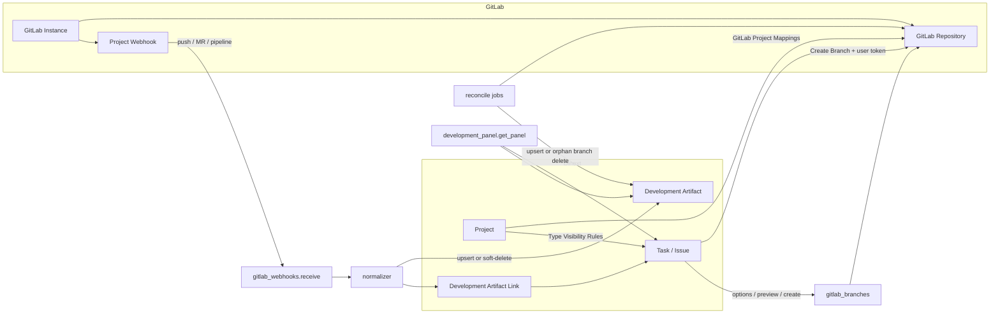

[Русский](README.ru.md)

# Dinext Git

## 📖 Overview

**Dinext Git** is a Frappe application for GitLab traceability within Dinext. It links standard `Task` and `Issue` documents to branches, commits, merge requests, pipelines, jobs, deployments, releases and tags; displays development status directly in the Dinext form; and lets the team work without Jira as a separate development tracker.

The application extends `dinext_projects` rather than replacing it: planning and task ownership remain in Dinext, while GitLab becomes the source of development facts. The target traceability model is `Issue/Task -> branch -> MR -> pipeline/job -> deployment/release`.

## ✨ Features

- Multi-instance GitLab configuration through `GitLab Instance`
- Multiple `Project -> GitLab project` mappings through the `GitLab Project Mappings` child table on the `Development` tab
- Development tab visibility rules by `Task`/`Issue` type through the `GitLab Type Visibility Rules` child table on the `Project` form
- A separate **Development** tab on the `Task` and `Issue` forms, shown only when the project has a GitLab mapping and the type visibility rules are satisfied
- Branch creation from `Task`/`Issue` with a branch name preview, default mapping, manual GitLab repository selection, an editable `branch_naming_template`, and `Base branch` selection from a live GitLab list
- Multiple branches for one `Task`/`Issue`, including multiple branches in the same GitLab repository
- Personal GitLab tokens on `User` for `Create Branch`, without falling back to a system token
- Automatic GitLab webhook registration, verification and recovery from Dinext
- GitLab webhook ingestion (`push`, `merge request`, `pipeline`, `tag push`, `release`) with an event log and idempotent normalization
- Soft-delete synchronization: objects deleted in GitLab are marked `artifact_status = deleted` in Dinext and excluded from summaries, the Development tab and reports (history and links are retained)
- A generic development artifact model (`Development Artifact`, `Development Artifact Link`)
- Development summary projection into standard `Task` and `Issue`, including the canonical `custom_git_development_status` (`Not started`, `In progress`, `Merged`, `Declined`, `Pipeline failed`, `Deployed`)
- A **Development Status** column and standard filter in `Task`/`Issue` list views; localized labels through `doctype_list_js`
- A shared Development tab UI module (`development_panel_ui.js`, `development_panel.css`): status pills, author chips, GitLab project/MR links and artifact grouping by repository
- Configurable workflow automation through `Development Workflow Rule`
- A Development block on the `Task` and `Issue` forms
- Script Reports for traceability exceptions and release composition
- **Development** workspace — the team's Git cockpit: 12 Number Cards for `custom_git_development_status` and `custom_git_discrepancy_flags`, warnings, reports and integration settings (without duplicating My Tasks / My Projects from `dinext_projects`)
- Russian localization of the UI and statuses through [`dinext_git/translations/ru.csv`](dinext_git/translations/ru.csv)
- Scheduled reconciliation and webhook health checks
- Migration of legacy Jira-style keys into `Development Key Alias`
- Metadata-aware Dinext key matching during GitLab metadata ingestion: naming patterns come from `Task`/`Issue` Meta, with support for manual names and the alias registry

### Application boundaries

| Area | Implemented in |
|---------|-----------------|
| Project management, timesheets, Issue extensions | `dinext_projects` |
| Gantt, burndown, story points | `dinext_project_tasks_gantt` |
| Stage-gate, scope, P&L | `dinext_project_stage_gate`, `dinext_project_scope`, `dinext_projects_pl` |
| Git/GitLab traceability, dev workflow | **Dinext Git** |
| Personal task and project lists (`Мои задачи`, `Мои проекты` — My Tasks, My Projects) | `dinext_projects` |
| Git development summary, traceability exceptions, release composition | **Dinext Git** (**Development** workspace) |

## 🚀 Installation

Install the application into an existing Administrator that already has `erpnext`, `dinext_common` and `dinext_projects`:

```bash
cd /path/to/frappe-bench
bench get-app https://dinext.gitlab.yandexcloud.net/erpnext/dinext/dinext-git.git --branch develop
bench --site your-site.local install-app dinext_git
bench --site your-site.local migrate
bench --site your-site.local export-fixtures --app dinext_git
bench build --app dinext_git
```

If you apply metadata changes in developer mode, make sure it is enabled on the site before creating or updating DocTypes:

```bash
bench --site your-site.local set-config developer_mode 1
```

## 🛠️ Usage

### Operator setup

1. Create a `GitLab Instance` record and specify:
   - `base_url`
   - `api_token`
   - `webhook_secret`
   - `verify_ssl`
   - `timeout_seconds`
2. For each Dinext project, open `Project -> Development` and fill in the **GitLab Project Mappings** child table:
   - `gitlab_instance`
   - `gitlab_group_path`
   - `gitlab_project_path`
   - `default_base_branch`
   - `branch_naming_template`
   - `enabled`
   - `is_default` for one primary repository
3. If a project has multiple mappings, keep exactly one enabled row marked **Default Mapping**.
4. If necessary, fill in the **GitLab Type Visibility Rules** child table in the Development section of the `Project` form:
   - `target_doctype`: `Task` or `Issue`
   - `task_type` or `issue_type`: the specific type for which the Development tab is shown
   - leaving the type field empty makes the Development tab available for **all** types of that DocType
   - if the DocType has no rules, no type restriction is applied
5. Invoke the webhook admin action (`sync` / `verify`) from Dinext to register or restore the hook.
6. Every developer using **Create Branch** must fill in **GitLab Branch Token** on their `User`.

System fields in `GitLab Project Mapping` rows (`webhook_status`, `webhook_last_error`, `last_reconciled_*`, etc.) are managed by the application and are read-only. Field properties (`read_only`, `hidden`, `is_default`, etc.) are defined in the `GitLab Project Mapping` DocType itself, rather than through `Property Setter` / `Custom Field` on that DocType.

### Required GitLab token scopes

- For `GitLab Instance.api_token`:
  - project and repository read access
  - reading the branch list (for orphan branch reconciliation)
  - managing project webhooks
  - reading MR / pipeline / job / release data for reconciliation
- For `User.GitLab Branch Token`:
  - access to the selected GitLab repository
  - reading the branch list (to select `Base branch` in the **Create Branch** dialog)
  - branch creation

`Create Branch` uses only the user's personal **GitLab Branch Token** and does not fall back to `GitLab Instance.api_token`.

### Team workflow

1. Development starts from a Dinext `Task` or `Issue`.
2. Before the first **Create Branch**, the developer fills in **GitLab Branch Token** in their profile.
3. If the project has a GitLab mapping and the document type is permitted by visibility rules, the form displays the **Development** tab with a development block and a **Create Branch** button.
4. The developer uses **Create Branch** or manually includes the Dinext key in the branch/MR/commit.
5. The **Create Branch** dialog opens with the default GitLab repository, its `branch_naming_template` and `default_base_branch` already selected. The user can change the template once (without saving it to the mapping) and choose `Base branch` from the live GitLab branch list; Dinext calculates the final branch name preview on the server.
6. One `Task`/`Issue` can have multiple branch artifacts; an existing active branch does not prevent creating another.
7. If a project has multiple GitLab mappings, Dinext uses **Default Mapping** for the initial preview; if none is default, it uses the first enabled mapping. Another repository can be selected in the dialog.
8. Recommended naming convention: the branch, MR title and commit message should contain the **Dinext key** (the work item's actual `name`).
9. Legacy Jira keys and other alternative identifiers resolve through `Development Key Alias`; the canonical reference for new artifacts is the Dinext key.
10. For a team and team lead overview, use the **Development** workspace in the Dinext Git module (see below).

### Development workspace

The standard Frappe Workspace is a single entry point into the Git/traceability context. It **does not replace** the `dinext_projects` workspaces for personal task and project work; it provides only an aggregated development view based on `custom_git_development_status`, `custom_git_discrepancy_flags` and `custom_git_artifact_count` on `Task`/`Issue`.

**Access:** `Dinext_User` and `System Manager` roles.

**Delivery:** the JSON [`dinext_git/dinext_git/workspace/разработки/разработки.json`](dinext_git/dinext_git/workspace/разработки/разработки.json) and 12 Number Cards in [`dinext_git/dinext_git/number_card/`](dinext_git/dinext_git/number_card/) synchronize during `bench migrate` as module metadata.

| Section | Content |
|--------|------------|
| **Development Summary** | 6 Number Cards by `custom_git_development_status`: In Development, Merged, Deployed for `Task` and `Issue` |
| **Warnings and Exceptions** | 6 Number Cards: discrepancies (`custom_git_discrepancy_flags`), Declined (`Declined`), `Pipeline failed` for `Task`/`Issue`; shortcuts to **GitLab Traceability Exceptions**, **GitLab Release Composition** reports and the **Development Artifact** list |
| **Reports and Settings** | Link cards: artifacts, `GitLab Instance`, workflow rules, alias registry, event log, reconciliation |

Number Cards open filtered `Task`/`Issue` lists. Script Reports and the **Development Artifact** DocType provide detailed exception analysis.

**v2 (not in the initial delivery):** dashboard charts, a custom development board block, additional KPIs.

After installing or updating the application:

```bash
bench --site your-site.local install-app dinext_git   # if the application is not installed yet
bench --site your-site.local migrate
```

### Dinext key matching (GitLab → Dinext)

Reverse work item mapping from branch/MR/commit/pipeline metadata is performed by [`matcher.py`](dinext_git/services/gitlab/matcher.py) through `resolve_keys()`. It is called from [`normalizer.py`](dinext_git/services/gitlab/normalizer.py) during webhook ingestion and reconciliation.

| Direction | Key source | Behavior |
|-------------|----------------|-----------|
| Dinext → GitLab | `doc.name` | **Create Branch** always inserts the actual `name` into the branch template's `{key}` |
| GitLab → Dinext | branch, MR title/description, commit message, pipeline ref | Candidate extraction + verification against `Task`/`Issue` and the alias registry |

Candidate extraction has two levels:

1. **Meta-derived patterns** — regular expressions are built from `frappe.get_meta()` for `Task` and `Issue`:
   - expression autoname (for example, `TASK-.YYYY.-.#####`);
   - `naming_series:` and all options of the `naming_series` field (for example, `ISS-.YYYY.-` → `ISS-.YYYY.-.#####`).
   - Property Setter and other metadata overrides already included in Meta are accounted for.
2. **Fallback** — enabled `Development Key Alias` records, generic token extraction with branch slug suffix trimming (`feature/{key}-sample` → `{key}`), and a legacy Jira-style pattern.

Candidate resolution:

- exact `name` match in `Task` or `Issue` (original case and uppercase);
- otherwise, lookup in `Development Key Alias`.

Scenarios:

| Scenario | Create Branch | Automatic linking from GitLab |
|----------|---------------|------------------------|
| Standard Task/Issue key from naming series | OK | OK |
| Manual work item name (`prompt`, import, custom `name`) | OK | OK through generic fallback + verification |
| Legacy Jira key | OK if the branch key is the Dinext name | OK through `Development Key Alias` |
| Custom naming series on the site | OK | OK after updating Meta (the matcher cache refreshes on worker restart / `clear_matcher_caches`) |

If the key is not recognized automatically, add a **Development Key Alias** record with type `Dinext Key` or `Jira Legacy Key`.

### Create Branch dialog

When a `Task`/`Issue` form opens, the server provides dialog bootstrap data through `development_panel.get_panel`:

| Payload field | Purpose |
|--------------|------------|
| `default_mapping_name` | Initial GitLab repository (default mapping or fallback) |
| `default_branch_template` | Branch naming template from the mapping |
| `default_base_branch` | Base branch from the mapping |
| `available_base_branches` | Live GitLab branch list for the selected repository |
| `branch_preview` | Server-side branch name preview using the initial values |
| `branch_mapping_options` | Mapping list if multiple mappings exist |

UI logic is in [`task_development.js`](dinext_git/public/js/task_development.js), [`issue_development.js`](dinext_git/public/js/issue_development.js), and the shared [`development_panel_ui.js`](dinext_git/public/js/development_panel_ui.js) module:

1. The dialog opens with the template and base branch already populated.
2. **Branch naming template** is a one-time override for the current creation; `GitLab Project Mapping.branch_naming_template` remains unchanged.
3. **Base branch** selects from `available_base_branches`; changing the mapping reloads the list through `gitlab_branches.options`.
4. Preview and creation always run through the server (`preview` / `create`) with `mapping_name`, `branch_template`, `base_branch` parameters.

Supported `branch_naming_template` placeholders:

| Placeholder | Value |
|-------------|----------|
| `{key}` | The work item's Dinext key (required in the template) |
| `{slug}` | Slug from the work item subject |
| `{doctype}` | `task` or `issue` |
| `{type_slug}` | `feature` for Task, `bugfix` for Issue |
| `{project}` | slug Dinext project |

The server also checks that the final branch name contains the Dinext key, is a valid git ref and does not conflict with an existing branch in GitLab or among active artifacts.

If the GitLab API is unavailable or the user has no **GitLab Branch Token**, `can_create_branch` becomes `false`, and `branch_error` is included in the payload. On form opening, the UI shows this warning through a yellow `frappe.show_alert`, rather than a modal; **Create Branch** is hidden. In the **Create Branch** dialog, the same error appears inline instead of the preview.

### Deletion synchronization (soft delete)

When an object disappears in GitLab, Dinext does not physically delete `Development Artifact` and `Development Artifact Link`. The artifact enters the tombstone state `artifact_status = deleted`, while links remain for auditing and reuse if the object reappears in GitLab.

Two synchronization channels:

| Channel | Trigger | Action |
|-------|-------------------|------------|
| Webhook `Push Hook` | GitLab sends a delete push (`after` / `checkout_sha` is an all-zero SHA) | Marks the branch artifact `deleted`, creates no commit artifacts, recalculates `custom_git_*` for linked `Task`/`Issue`, applies `Development Workflow Rule` for `branch_deleted` |
| Scheduled reconciliation | Hourly/daily `reconcile_mapping` job | Compares MR/pipeline/release data through the GitLab API and branch lists with local artifacts; marks remotely absent branches `deleted`, updates affected work item summaries and applies `branch_deleted` workflow rules |

Product behavior:

- deleted artifacts are excluded from `custom_git_*` summaries on `Task`/`Issue`;
- they are hidden on the **Development** tab (deleting a branch makes **Create Branch** available again);
- traceability and release composition reports include only active artifacts.

### Development Workflow Rule

`Development Workflow Rule` transitions the linked `Task`/`Issue` on development events. The rule is configured in Desk and supports:

- **Target DocType**: `Task` or `Issue`
- **Project**: optional scope; an empty value means a rule for all projects
- **Development Event**: development event
- **Target Field**: a `Select` or `Link` DocType field storing the workflow state (default: `status`)
- **Target Value** / **Only When Current Value**: target value and a guard on the selected field's current value
- **Priority** / **Stop After Apply**: application order and stopping after the first successful rule

Supported events:

| Event | Source |
|---------|----------|
| `branch_created` | Create Branch from Dinext |
| `branch_linked` | GitLab Push Hook (not a delete push) |
| `branch_deleted` | GitLab delete push or deleted branch reconciliation |
| `mr_opened` | Merge Request Hook (`open` / `reopen`) |
| `mr_review_started` | Merge Request Hook (`update` changing reviewers) |
| `mr_changes_requested` | Merge Request Hook (`unapproved`) |
| `mr_approved` | Merge Request Hook (`approved`) |
| `mr_merged` | Merge Request Hook (`merge` / `state=merged`) |
| `pipeline_failed` / `pipeline_succeeded` | Pipeline Hook |
| `deployment_succeeded` | Pipeline Hook with a successful build/environment |

A rule is applied through a full `Document.save()` of the selected `Task`/`Issue`, rather than `frappe.db.set_value`. If the save cycle fails (for example, a `Task` moves to `Completed` without the required `completed_on`), the document remains unchanged and the error is recorded in Error Log.

After `bench migrate`, existing rules automatically receive `target_fieldname = status`.

### Development Status

The `custom_git_development_status` field on `Task`/`Issue` is a read-only projection from active `Development Artifact` records. Canonical Select values (and Number Card filters) are defined in [`constants.py`](dinext_git/services/gitlab/constants.py):

| Status | Set when |
|--------|-------------------|
| `Not started` | No active artifacts |
| `In progress` | A branch or open MR exists |
| `Merged` | A merged MR exists |
| `Declined` | A closed/declined MR exists without an open/merged one |
| `Pipeline failed` | The latest pipeline has status `failed` (overrides merged/in progress) |
| `Deployed` | The latest deployment has status `success` (highest priority) |

The calculation runs in [`projector.py`](dinext_git/services/gitlab/projector.py); `custom_git_discrepancy_flags`, `custom_git_artifact_count`, and links to filtered MR lists in GitLab are also projected.

The [`migrate_development_status_select_values`](dinext_git/patches/v0_0/migrate_development_status_select_values.py) patch converts legacy machine codes (`in_progress`, `merged`, …) into canonical labels during upgrades.

### Upgrade notes

- After `bench migrate`, existing `GitLab Project Mapping` records automatically link to the `Project.custom_git_project_mappings` child table.
- One **Default Mapping** is automatically selected among enabled mappings if none was set previously.
- Webhook/reconciliation fields remain on `GitLab Project Mapping` rows but are managed from the project's **Development** tab.
- Legacy `custom_git_development_status` values (`in_progress`, `merged`, …) migrate to canonical Select labels through a post-migrate patch.

### API calls

Main whitelisted methods:

```python
dinext_git.api.development_panel.get_panel(doctype, name)
dinext_git.api.gitlab_branches.preview(doctype, name, mapping_name=None, branch_template=None, base_branch=None)
dinext_git.api.gitlab_branches.create(doctype, name, mapping_name=None, branch_template=None, base_branch=None)
dinext_git.api.gitlab_branches.options(doctype, name, mapping_name=None)
dinext_git.api.gitlab_webhook_admin.sync(mapping_name, force=0)
dinext_git.api.gitlab_webhook_admin.verify(mapping_name)
dinext_git.api.gitlab_webhook_admin.verify_and_sync_instance(instance_name)
```

The **GitLab Instance** form has a **Verify and Sync Webhooks** button: it runs `verify` for all enabled `GitLab Project Mapping` records in that instance, then `sync` only for `missing`, `drifted` and `failed` statuses. The result is shown in a Desk summary.

`get_panel` returns the Development tab payload, including bootstrap data for **Create Branch** (`default_branch_template`, `default_base_branch`, `available_base_branches`, `branch_preview`).

`gitlab_branches.options` returns the template, base branch, list of permitted base branches and preview for the selected mapping — used when switching the GitLab repository in the dialog.

`gitlab_branches.preview` / `create` accept a one-time `branch_template` override and an explicit `base_branch`; the `{slug}` slug is always calculated on the server from the work item subject.

Public webhook endpoint:

```text
POST /api/method/dinext_git.api.gitlab_webhooks.receive
```

## 📦 Technologies

- Python 3.10+
- Frappe Framework / ERPNext
- JavaScript form scripts and Script Reports
- Ruff for Python linting
- Prettier / ESLint / pyupgrade through pre-commit tooling

## 🔧 Configuration

The main application configuration is in [`dinext_git/hooks.py`](dinext_git/hooks.py).

Key settings and integration points:

- `required_apps = ["frappe/erpnext", "dinext/dinext_common", "dinext/dinext_projects"]`
- `doctype_js`:
  - `Task -> public/js/task_development.js`
  - `Issue -> public/js/issue_development.js`
- `doctype_list_js`:
  - `Task -> public/js/task_development_list.js`
  - `Issue -> public/js/issue_development_list.js`
- `scheduler_events`:
  - `hourly`: reconciliation and webhook health checks
  - `daily`: reconciliation
- `default_log_clearing_doctypes`: `GitLab Event Log` — 30 days
- Fixture exports only for `Custom Field` in the Dinext Git module (`fixtures/custom_field.json`)
- Module metadata (synchronized through `bench migrate`): Workspace, Number Cards, Reports, DocTypes

The application relies on site metadata and export-fixtures rather than environment variables.

### Metadata workflow

**Custom Field** changes follow **MCP/UI first**:

1. Update `Custom Field` in the system;
2. run `bench --site <site> migrate` if needed;
3. synchronize the repository through `bench --site <site> export-fixtures --app dinext_git`.

For DocType, Report, Number Card and Workspace, edit module JSON under `dinext_git/dinext_git/` (or use MCP followed by an export into the repository under the team's workflow).

For `GitLab Project Mapping`, change fields in the DocType (`dinext_git/dinext_git/doctype/gitlab_project_mapping/gitlab_project_mapping.json`), rather than through customization of that DocType.

**Do not** manually edit `fixtures/custom_field.json`.

## ✅ Requirements

- A working Administrator
- Installed applications:
  - `frappe`
  - `erpnext`
  - `dinext_common`
  - `dinext_projects`
- Access to run `bench --site <site> migrate`
- Developer mode enabled when creating/updating DocTypes or metadata in the database

## 🤝 Contributing

Before making changes, install and enable `pre-commit`:

```bash
cd apps/dinext_git
pre-commit install
```

The repository uses:

- `ruff`
- `eslint`
- `prettier`
- `pyupgrade`

Minimum checks before publishing changes:

```bash
bench --site your-site.local run-tests --app dinext_git
bench --site your-site.local export-fixtures --app dinext_git
```

Follow this process when changing metadata-driven behavior:

1. Update code and metadata in the system
2. Run site migration
3. Run targeted tests
4. Export fixtures

Project development rules are in [`AGENTS.md`](AGENTS.md).

## 📄 Documentation

- [`README.md`](README.md) — high-level project overview
- [`AGENTS.md`](AGENTS.md) — project doctrine and Frappe working rules
- [`dinext_git/hooks.py`](dinext_git/hooks.py) — application bootstrap, fixtures, scheduler and client script bindings
- [`dinext_git/api/development_panel.py`](dinext_git/api/development_panel.py) — Development tab payload, `show_gitlab_tab` calculation and type visibility rules
- [`dinext_git/api/gitlab_webhooks.py`](dinext_git/api/gitlab_webhooks.py) — public GitLab webhook ingestion
- [`dinext_git/api/gitlab_branches.py`](dinext_git/api/gitlab_branches.py) — preview, options and branch creation from the UI
- [`dinext_git/services/gitlab/store.py`](dinext_git/services/gitlab/store.py) — persistence, `mark_artifact_deleted`, multi-mapping lookup
- [`dinext_git/services/gitlab/projector.py`](dinext_git/services/gitlab/projector.py) — summary projection onto `Task`/`Issue` (excluding deleted artifacts)
- [`dinext_git/services/gitlab/branch_actions.py`](dinext_git/services/gitlab/branch_actions.py) — branch creation business logic and user-scoped tokens
- [`dinext_git/services/gitlab/matcher.py`](dinext_git/services/gitlab/matcher.py) — metadata-aware extraction and resolution of Dinext keys from GitLab metadata
- [`dinext_git/services/gitlab/normalizer.py`](dinext_git/services/gitlab/normalizer.py) — webhook payload normalization into artifacts
- [`dinext_git/services/gitlab/reconcile.py`](dinext_git/services/gitlab/reconcile.py) — reconciliation and webhook health
- [`dinext_git/services/gitlab/constants.py`](dinext_git/services/gitlab/constants.py) — artifact types, development status values, webhook events, workflow events
- [`dinext_git/services/gitlab/panel_metadata.py`](dinext_git/services/gitlab/panel_metadata.py) — author avatars, artifact decoration, UI timestamps
- [`dinext_git/public/js/development_panel_ui.js`](dinext_git/public/js/development_panel_ui.js) — shared UI: status pills, artifact list, GitLab project links
- [`dinext_git/public/js/task_development.js`](dinext_git/public/js/task_development.js) — Development tab form script on `Task`
- [`dinext_git/public/js/issue_development.js`](dinext_git/public/js/issue_development.js) — Development tab form script on `Issue`
- [`dinext_git/public/js/task_development_list.js`](dinext_git/public/js/task_development_list.js) — `Task` list view formatter for `custom_git_development_status`
- [`dinext_git/public/js/issue_development_list.js`](dinext_git/public/js/issue_development_list.js) — `Issue` list view formatter
- [`dinext_git/public/css/development_panel.css`](dinext_git/public/css/development_panel.css) — Development tab styles
- [`dinext_git/translations/ru.csv`](dinext_git/translations/ru.csv) — Russian translations of statuses and UI
- [`dinext_git/dinext_git/doctype/gitlab_type_visibility_rule/gitlab_type_visibility_rule.json`](dinext_git/dinext_git/doctype/gitlab_type_visibility_rule/gitlab_type_visibility_rule.json) — type visibility rules child table
- [`dinext_git/tests/test_development_panel_payload.py`](dinext_git/tests/test_development_panel_payload.py) — payload and type visibility tests
- [`dinext_git/tests/test_matcher.py`](dinext_git/tests/test_matcher.py) — metadata-aware key matching and webhook linking tests
- [`dinext_git/dinext_git/workspace/разработки/разработки.json`](dinext_git/dinext_git/workspace/разработки/разработки.json) — **Development** workspace
- [`dinext_git/dinext_git/number_card/`](dinext_git/dinext_git/number_card/) — 12 Number Cards for summaries and warnings
- [`dinext_git/tests/test_development_workspace.py`](dinext_git/tests/test_development_workspace.py) — workspace structure and Number Card consistency tests
- [`dinext_git/tests/test_dev_status_projection.py`](dinext_git/tests/test_dev_status_projection.py) — `custom_git_development_status` calculation tests
- [`dinext_git/tests/test_workflow_sync.py`](dinext_git/tests/test_workflow_sync.py) — `Development Workflow Rule` tests
- [`dinext_git/tests/test_translations.py`](dinext_git/tests/test_translations.py) — translatable string validation

## 📝 Changelog

- **Initial scaffold** — the foundational Dinext Git Frappe application with GitLab traceability, webhook ingestion, reconciliation, reports and a development panel for `Task`/`Issue`.
- **Multi-mapping** — one Dinext `Project` can reference multiple GitLab repositories through a child table on the `Development` tab.
- **User-scoped tokens** — `Create Branch` uses the personal `User.GitLab Branch Token`.
- **Multi-branch work items** — one `Task` or `Issue` can link to multiple branches; an active branch does not prevent another from being created.
- **Create Branch dialog** — a one-time `branch_naming_template` override, `Base branch` selection from a live GitLab list, and default mapping bootstrap when the dialog opens; mapping defaults are not overwritten.
- **Type visibility rules** — the `GitLab Type Visibility Rules` child table restricts Development tab visibility by `Task`/`Issue` type; an empty type in a rule means all types of that DocType are permitted.
- **Soft-delete sync** — GitLab branch deletion through a delete-push webhook or orphan detection during reconciliation; the `artifact_status = deleted` tombstone, exclusion from summaries, the Development tab and reports.
- **Meta-aware key matching** — GitLab → Dinext work item resolution using `Task`/`Issue` Meta naming settings, manual names, generic token fallback and `Development Key Alias`; Create Branch still uses the actual `doc.name`.
- **Development workspace** — a Git cockpit with 12 Number Cards for Git statuses, discrepancies and warnings, traceability/release report shortcuts and integration setup link cards; `Dinext_User` read access to reports and artifacts.
- **Development Status v2** — canonical Select labels (`Not started`, `In progress`, `Merged`, `Declined`, `Pipeline failed`, `Deployed`) instead of legacy machine codes; `Declined` for an MR closed without merging; a post-migrate backfill patch.
- **Shared development panel UI** — `development_panel_ui.js` + CSS: status pills, author chips, artifacts grouped by GitLab repository, project/MR links.
- **List view integration** — a `Development Status` column and formatter in `task_development_list.js` / `issue_development_list.js`.
- **Tag/release webhook ingest** — normalization of `tag_push` and `release` events into `tag`/`release`/`deployment` artifacts.
- **Workflow rule engine** — extended MR review, pipeline and deployment events; modular `workflow_events.py`, `workflow_fields.py`, `workflow_sync.py` structure.
- **Russian localization** — extended `ru.csv` for statuses, the Development tab and Workspace.

## 🗂️ Repository structure

```text
.
├── AGENTS.md
├── README.md
├── pyproject.toml
└── dinext_git/
    ├── hooks.py
    ├── modules.txt
    ├── patches.txt
    ├── tasks.py
    ├── translations/
    │   └── ru.csv
    ├── api/
    │   ├── development_panel.py
    │   ├── gitlab_branches.py
    │   ├── gitlab_webhook_admin.py
    │   └── gitlab_webhooks.py
    ├── fixtures/
    │   └── custom_field.json
    ├── patches/v0_0/
    │   ├── migrate_development_status_select_values.py
    │   └── migrate_legacy_jira_aliases.py
    ├── public/
    │   ├── css/
    │   │   └── development_panel.css
    │   └── js/
    │       ├── development_panel_ui.js
    │       ├── issue_development.js
    │       ├── issue_development_list.js
    │       ├── task_development.js
    │       └── task_development_list.js
    ├── services/
    │   ├── gitlab/
    │   │   ├── branch_actions.py
    │   │   ├── client.py
    │   │   ├── constants.py
    │   │   ├── matcher.py
    │   │   ├── normalizer.py
    │   │   ├── panel_metadata.py
    │   │   ├── payloads.py
    │   │   ├── projector.py
    │   │   ├── reconcile.py
    │   │   ├── store.py
    │   │   ├── utils.py
    │   │   ├── validators.py
    │   │   ├── webhook_admin.py
    │   │   ├── workflow_events.py
    │   │   ├── workflow_fields.py
    │   │   └── workflow_sync.py
    │   └── reports/
    │       ├── release_composition.py
    │       └── traceability.py
    ├── tests/
    │   ├── test_branch_actions.py
    │   ├── test_development_panel_payload.py
    │   ├── test_development_status_migration.py
    │   ├── test_development_workspace.py
    │   ├── test_dev_status_projection.py
    │   ├── test_gitlab_event_log.py
    │   ├── test_gitlab_webhook_admin.py
    │   ├── test_gitlab_webhook_ingest.py
    │   ├── test_gitlab_webhook_receive.py
    │   ├── test_legacy_alias_migration.py
    │   ├── test_matcher.py
    │   ├── test_panel_metadata.py
    │   ├── test_reconciliation.py
    │   ├── test_release_composition_report.py
    │   ├── test_traceability_reports.py
    │   ├── test_translations.py
    │   ├── test_utils.py
    │   ├── test_webhook_payload.py
    │   └── test_workflow_sync.py
    └── dinext_git/
        ├── number_card/
        │   ├── git_dev_tasks_in_progress/
        │   ├── git_dev_tasks_merged/
        │   ├── git_dev_tasks_deployed/
        │   ├── git_dev_tasks_declined/
        │   ├── git_dev_tasks_discrepancies/
        │   ├── git_dev_tasks_pipeline_failed/
        │   └── … (Issue variants)
        ├── workspace/
        │   └── разработки/
        │       └── разработки.json
        ├── doctype/
        │   ├── development_artifact/
        │   ├── development_artifact_link/
        │   ├── development_key_alias/
        │   ├── development_workflow_rule/
        │   ├── gitlab_event_log/
        │   ├── gitlab_instance/
        │   ├── gitlab_project_mapping/
        │   ├── gitlab_type_visibility_rule/
        │   └── reconciliation_cursor/
        └── report/
            ├── gitlab_release_composition/
            └── gitlab_traceability_exceptions/
```

Structure notes:

- `dinext_git/dinext_git/doctype/` contains metadata-backed DocType definitions and controllers.
- `dinext_git/dinext_git/number_card/` and `dinext_git/dinext_git/workspace/` contain Git cockpit module metadata; synchronized through `bench migrate`.
- `dinext_git/services/gitlab/` contains the GitLab client, webhook normalization, reconciliation, branch actions, constants and summary projection.
- `dinext_git/api/` contains whitelisted endpoints for the UI, webhook administration and public ingestion.
- `dinext_git/public/js/` and `public/css/` contain `Task`/`Issue` form client scripts, list view formatters and shared Development tab UI.
- `dinext_git/fixtures/custom_field.json` contains exported Custom Fields; edited only through MCP/UI and export-fixtures.
- `dinext_git/translations/ru.csv` contains Russian UI and status translations.
- `dinext_git/tests/` contains traceability flow integration and unit tests.

## 🔗 Flow Chart



Data flow:

1. The operator configures `GitLab Instance`, mappings and, if necessary, type visibility rules on `Project`.
2. The developer works from `Task`/`Issue`; the server calculates `show_gitlab_tab` from mappings and type rules.
3. GitLab sends a webhook to Dinext; the normalizer creates, updates or marks `Development Artifact` as `deleted`, and maintains work item links.
4. Reconciliation and webhook health jobs resolve differences between GitLab and Dinext, including branches deleted in GitLab without a delivered webhook.
5. The form UI requests a payload from `development_panel.get_panel` and displays only active artifacts, summaries and branch actions; **Create Branch** uses `gitlab_branches.options`, `preview` and `create`.
6. The **Development** workspace shows aggregate Git fields on `Task`/`Issue`, warnings and quick access to traceability/release reports and integration settings.

## Validation and debugging

### Main checks

```bash
bench --site your-site.local run-tests --app dinext_git
bench --site your-site.local export-fixtures --app dinext_git
```

### If Create Branch is unavailable or its preview fails

Check:

- whether the current user has filled in **GitLab Branch Token**;
- whether the personal token has sufficient scopes to read branches and create a branch in the selected repository;
- whether `Project -> Development` has an enabled mapping and a valid `branch_naming_template` (must contain `{key}`);
- the `can_create_branch` and `branch_error` values in the `development_panel.get_panel` payload;
- GitLab API availability for `list_branches` (the `Base branch` list in the dialog);
- whether the selected base branch exists remotely (`Base branch {0} was not found...`).

### If a webhook did not run

Check:

- `GitLab Event Log` for delivery status and payload
- `Log Settings` if historical `GitLab Event Log` records disappeared because of the retention policy;
- the **GitLab Project Mappings** row on the `Project -> Development` tab
- `GitLab Project Mapping.webhook_status`
- `GitLab Project Mapping.webhook_last_error`
- scheduler job `verify_webhook_health`

### If an artifact was not linked to Task/Issue

Check:

- whether the branch/MR title/commit message contains the **actual Dinext key** (document `name`), rather than only the subject or legacy alias;
- whether **Development Key Alias** has a record for nonstandard names and custom naming series;
- after changing `autoname` / `naming_series` on `Task` or `Issue`, restart workers (the matcher caches Meta patterns);
- `Development Artifact Link.extracted_key` and `link_source` on the linked artifact — these help identify the text recognized by the matcher;
- the **GitLab Traceability Exceptions** report and [`test_matcher.py`](dinext_git/tests/test_matcher.py) tests as a reference for expected behavior.

### If reconciliation is falling behind

Check:

- the **GitLab Project Mappings** row on the `Project -> Development` tab
- `GitLab Project Mapping.last_reconciled_mr_at`
- `GitLab Project Mapping.last_reconciled_pipeline_at`
- `Reconciliation Cursor`
- the `run_hourly_reconciliation` and `run_daily_reconciliation` scheduler jobs

### Retention GitLab Event Log

`GitLab Event Log` uses Frappe's standard **Log Settings** mechanism. Records are cleaned after a default retention of `30` days, but the operator can change it in `Log Settings -> Logs to Clear` for the `GitLab Event Log` DocType.

### If a branch was deleted in GitLab but remains live in Dinext

Check:

- whether a delete push arrived in `GitLab Event Log` (`Push Hook` type, `after` / `checkout_sha` containing an all-zero SHA in the payload);
- `Development Artifact.artifact_status` for the branch — the expected value is `deleted`;
- whether reconciliation ran: the mapping must have GitLab API access to read branches; the `branches_deleted` field in `reconcile_mapping` results reports the number of tombstone operations in that run;
- whether `custom_git_*` was recalculated on the linked `Task`/`Issue` after the tombstone operation.

### If the workflow did not transition

Check:

- `custom_git_*` summary fields on `Task`/`Issue`
- the presence and order of `Development Workflow Rule` records
- whether the rule applies to the intended `Project`, `Target Field` and `Target Value`
- Error Log for `Dinext Git workflow rule failed`
- event log / normalized artifact links
- the **GitLab Traceability Exceptions** report

### If the Development tab is not displayed

Check:

- whether an enabled mapping exists on `Project -> Development`
- whether `Task.type` / `Issue.issue_type` is covered by **GitLab Type Visibility Rules**
- whether a blank rule permits all types for the corresponding DocType
- the `show_gitlab_tab` response in the `development_panel.get_panel` payload

### If the Development workspace is hidden or empty

Check:

- whether `dinext_git` is installed on the site (`bench --site <site> list-apps`);
- whether `bench --site <site> migrate` ran after the repository update;
- whether the user has `Dinext_User` or `System Manager`;
- whether Desk → Workspace has a **Development** record in the Dinext Git module;
- whether Number Cards from `dinext_git/dinext_git/number_card/` were synchronized through `bench migrate` (Dinext Git module).

## Reports

Reports are available from the **Development** workspace, link cards and directly from the Dinext Git module. The `Dinext_User` role has read access to both Script Reports.

- **GitLab Traceability Exceptions**
  - tasks without MR
  - MR without task
  - failed pipelines
  - stuck reviews
  - tasks in release without merge
- **GitLab Release Composition**
  - release composition by Dinext tasks and GitLab facts (`release`, `tag`, `deployment` when a merged MR exists)

## License

GNU GPL v3. See [license.txt](license.txt) for the license text.
